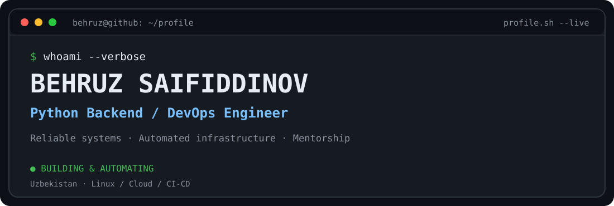
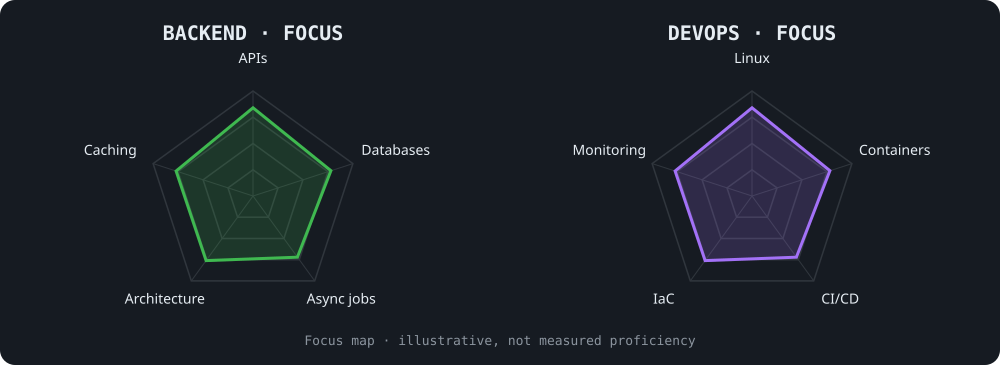

<picture>
  <source media="(prefers-color-scheme: dark)" srcset="assets/banner-dark.svg">
  <source media="(prefers-color-scheme: light)" srcset="assets/banner-light.svg">
  
</picture>

  
  
  

---

## This is me :)

Hi! I'm **Behruz Saifiddinov**, a **Python Backend & DevOps Engineer** based in Uzbekistan 🇺🇿.

I design APIs and backend services, deploy and operate infrastructure, improve delivery pipelines, and teach engineers how real systems work.

- 🛠️ **Backend engineering:** Python, FastAPI, Django, async services, PostgreSQL, Redis, Celery.
- ⚙️ **DevOps:** Linux, Docker, GitLab CI/CD, GitHub Actions, Ansible, Terraform/OpenTofu, and Kubernetes labs.
- 📈 **Observability:** Prometheus, Grafana, Loki and telemetry collection.
- 👨‍🏫 **Mentorship:** Senior Python Mentor and DevOps Engineer at Fido-Biznes Academy.
- 🌱 **Current interests:** platform engineering, automation, Kubernetes, resilient deployments and performance optimization.
- 💬 **Let's talk about:** Python, system design, containers, Linux, monitoring and CI/CD.

---

## my perfect stack`

---

## signals

<picture>
  <source media="(prefers-color-scheme: dark)" srcset="assets/radar-dark.svg">
  <source media="(prefers-color-scheme: light)" srcset="assets/radar-light.svg">
  
</picture>

These radars visualize areas of focus, not independently measured proficiency.

---

## Selected experience

**Fido-Biznes Academy — Senior Python Mentor & DevOps Engineer**  
Self-hosted GitLab and runner setup, Redmine deployment, Linux/CI-CD labs, and engineering mentorship.

**ORB IT — Python Backend / DevOps Engineering**  
Backend services, deployments and infrastructure work.

### Infrastructure highlights

- **GitLab for education:** self-hosted GitLab CE, runner integration, internal hostname/DNS coordination and course-ready CI/CD.
- **Kubernetes lab:** provisioned Ubuntu virtual machines with Proxmox + OpenTofu; configured inventory and cluster access using Ansible; deployed and tested services.
- **Monitoring:** Prometheus, Grafana, Loki and Alloy across server environments.
- **Platform migration:** Docker Compose services and PostgreSQL migration with backup/restore validation.

---

## Selected projects · Resume / HH

| Project | Area | Contribution |
|:--|:--|:--|
| **Automation Soft Platform** | DevOps / Browser automation | Optimized concurrent Chromium jobs (up to 50 instances); reduced per-job runtime from about 82 to 25–40 minutes and configured proxy routing across two servers. |
| **Alloplay** | Backend | Gaming/entertainment platform with backend services and deployment work. |
| **UstaHub** | Backend / Infrastructure | Marketplace APIs, database design and deployment automation. |
| **IlmTech** | Backend | Educational platform and application services. |
| **UMOS** | Monitoring | Uptime monitoring platform. |
| **Selfie REST** | DevOps | Deployment and infrastructure for the Selfie REST / Telegram bot project. |
| **Space Gaming System** | DevOps | Infrastructure and deployment work for the gaming platform. |
| **Dilbaroy Clinic CRM** | DevOps | Infrastructure and deployment work for the clinic CRM. |

> Some commercial project repositories and infrastructure are private. Descriptions summarize my contributions without exposing internal implementation details.

---

## Numbers matter? GitHub activity

---

**Build → Automate → Observe → Improve**

Behruz Saifiddinov · Backend &amp; DevOps · Uzbekistan 🇺🇿

